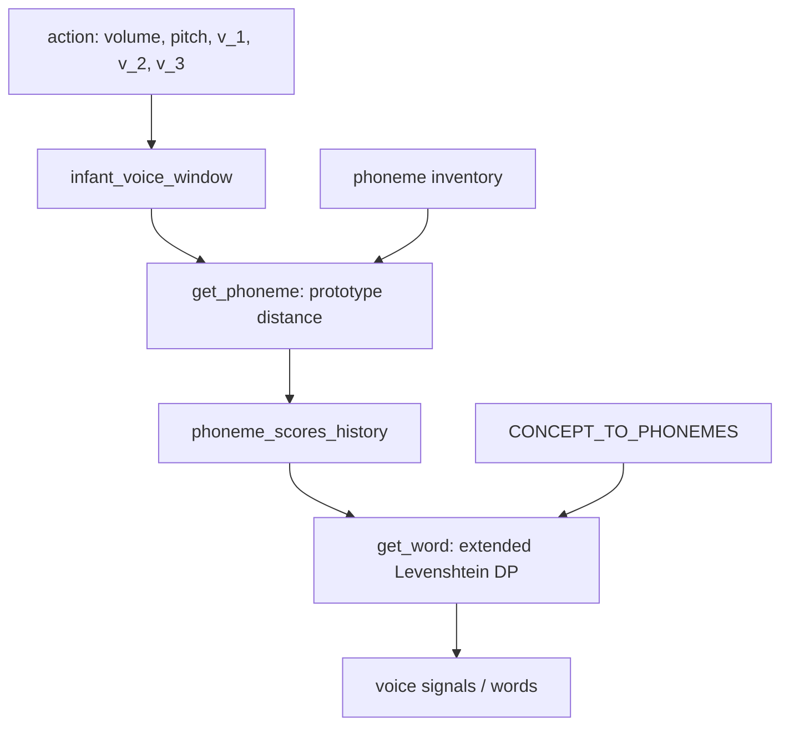

# Voice Plan

## 1. 目的と設計原則

cueworld の音声は，いきなり生音声へ移るのではなく，まず抽象音声表現（`easy_voice`）を改善し，将来の生音声・スペクトル特徴へ移行できる形へ整理するハイブリッド方針とする．

重要なのは次の点である．

- 親が幼児の曖昧な発話から意図を推測できる性質は残す．
- 「ズレを許容した照合」をやめるのではなく，「ズレを許容しても過剰に確定しない」方向へ改修する．
- **1 音の置換ミスは正解語へ結びつける**（幼児の未熟な発話への適応）．
- 2 音以上のミスは，少なくとも別の語へ誤確定しない（棄却してよい）．
- `pitch` は音素軸に混ぜず，独立した韻律・音高要素として扱う．
- 発声表現・認識器・語彙と評価を分離して設計する．

## 2. 現状の実装（事実ベース）

- action は 17 次元．音声観測は `volume`, `pitch`, `v_1`, `v_2`, `v_3` の 5 次元．
- `pitch` は音素照合に含めず，`phoneme_index` 以降（`v_1`, `v_2`, `v_3`）のみを使う．
- `infant_signal.py` に 8 音素プロトタイプがあり，最近傍距離と 2 位との差分で `unknown` を返す．
- `get_word()` は拡張レーベンシュタイン距離で単語を照合し，距離・系列品質・margin で棄却する．
- `apply_phoneme_to_action()` で protocol / demo 側の発話出力を 3 次元音素座標へ寄せている．

## 3. 既知の不具合と設計上の問題

### 3-1. 語彙の 61% が完全に同一の音素列で，原理的に認識不能

`vocabulary.py` の 33 概念のうち 20 概念が他概念と完全一致の列を持つ（distinct 22 列）．
同一列は DP スコアも完全一致するため `margin = 0` となり，`word_margin_threshold` で必ず棄却される．

### 3-2. DP の置換コストが正規化されていない

`get_phoneme()` は生のユークリッド距離を返し，それが置換コストになる．
`v` 空間は `[-1,1]^3` なので距離の上限は約 3.46．一方 `cost_del = cost_ins = 1.0` なので単位が合わない．

### 3-3. DP テーブル初期化のインデックスバグ

`i = 0` で `X[-1]` / `D[-1][0]` を参照し，`D[0][0]` が 0 でなくなる．

### 3-4. 単語長バイアスが未処理

`D_norm = D[I][J] / max(I, 1)` は入力長 `I` でしか正規化しない．

### 3-5. 8 音素 inventory が未活用

語彙・テンプレートで使われているのは `a,o,e,i,u,n` の 6 種のみ．`m`, `y` は未使用．

### 3-6. その他

- `voice_pitch_history` は宣言・clear のみで未更新．`emotion_prototypes` も未使用．
- 発話出力コードが複数 protocol にコピペされている．
- `physical_contact.py` は独自 `utterance_set` に音素をハードコードしている．

## 4. 決定事項

- 音素ラベルは日本語音から切り離し，`p0`..`p7` の抽象ラベルにする．
- `v_1`, `v_2`, `v_3` は調音的意味を持たない直交する識別軸．
- 座標は 3 ビット符号で自己記述化する（`p5 = 0b101 -> (+1,-1,+1)`）．
- inventory は立方体 8 頂点から始め，必要なら 9〜10 個へ拡張する．
- `CONCEPT_TO_PHONEMES` は識別コード辞書．意味の自然さは `CONCEPT_TO_HUMAN_WORD` に任せる．
- 「曖昧な発話」は一様ノイズではなく「惜しい発話（near-miss）」と定義する．
- 語彙は固定長 5・最小ハミング距離 4 の 8 元符号とする．
  - k=1: 正解語へ訂正
  - k=2: 同点で棄却（誤確定しない）
  - k=3: 保証なし．棄却されるかを実測で確認

## 5. スコープ

今回コードを触るのは次のみ．

- `protocols/base.py`, `joint_attention.py`, `object_giving.py`, `imitation.py`
- `infant_signal.py`, `base.py`, `language/*`, tests, demo, docs
- `physical_contact.py` は `utterance_set` の音素名の機械的リネームのみ

対象外（後で大きく作り直す）: `object_play.py`, `dyadic_play.py`, `household_solo.py`,
および `physical_contact.py` の構造的リファクタ．

## 6. 実装ステップ

### Step 0: DP コストの単位統一とバグ修正

- `phoneme_cost_scale = 2.0` を導入し，スコアを `min(dist / scale, 1.0)` に正規化．
- しきい値を同単位で再定義．
- `D[0][0] = 0.0`，初期化ループを `range(1, I + 1)` に修正．
- 長さ正規化を `/I`, `/J`, `/(I+J)` で切替可能にする．

### Step 1: 評価基盤

- `cueworld/language/voice_eval.py` と `scripts/experiment/eval_voice_recognition.py`
- 軸 A: 音素置換数 k(1,2,3) x 元単語長 L
- 軸 B: 惜しい発話 level 0-3
- 無音・一様ランダムは偽陽性測定の別枠

### Step 2: 音素 inventory の抽象ラベル化

- `p0`..`p7`，3 ビット符号から座標生成．
- templates / imitation / tests / demo を追随更新．
- `physical_contact.py` は機械的リネームのみ．

### Step 3: 発話出力の集約

- `protocols/base.py` に `_emit_utterance()` を追加．
- `joint_attention.py` / `object_giving.py` / `imitation.py` のみ置換．

### Step 4: 語彙の自動最適化

- 固定長 5・最小ハミング距離 4 の 8 元符号から 33 語を選ぶ．
- 距離は認識器と同じコストモデルで計算する．
- 結果を `vocabulary.py` / `templates.py` へ反映．

### Step 5: 時間スケールの整合

- 確定値（memo B・C）: `PHONEME_DURATION_FRAMES=6` → 固定長 5 で **1単語=30フレーム**。
  `INTER_WORD_GAP_FRAMES=1`（単語間ソフト区切り。セグメント分割用ではない）。
- `voice_window_size` / `voice_interval` / `phoneme_history_length` / `word_interval` は
  この 30 フレーム単位に合わせて調整済み／維持する。
- テンプレートは概念ID列（機能語 → TARGET）。生音素タプルは廃止。

### Step 6: 発話セグメント認識

- onset / offset によるセグメント単位の単語更新．
- `VoiceRecognizer` クラスとして切り出す．
- プロトタイプの `radius` を距離計算に使う．

### Step 7: pitch の位置づけと文書更新

- `voice_pitch_history` を更新する．情動推定は現状未使用と明示．
- `docs/env.md`, `docs/infant_signal.md`, `docs/language.md` を更新．

## 7. 評価指標と受入基準

### 軸 A: 音素置換数 k

| k | 要求 |
|---|------|
| 1 | top-1 正解率 >= 0.95，誤確定 <= 0.02 |
| 2, 3 | 誤確定 <= 0.10（正解できればより良い） |

### 軸 B: 惜しい発話

| level | 内容 | 要求 |
|-------|------|------|
| 0 | 正確 | top-1 >= 0.98，誤確定 0 |
| 1 | 隣接方向へ 0.3，継続長 +-20% | top-1 >= 0.95 |
| 2 | 隣接方向へ 0.6 / 脱落 / 伸長（1 箇所） | top-1 >= 0.80，誤確定 <= 0.05 |
| 3 | level 2 を 2 箇所 | 誤確定 <= 0.10 |

### 偽陽性

- 無音: 単語確定率 <= 0.01
- 一様ランダム: 単語確定率 <= 0.05
- 完全一致衝突: 0 件
- 混同行列の最大非対角 <= 0.10

## 8. 変更対象ファイル

- `cueworld/infant_signal.py`
- `cueworld/base.py`
- `cueworld/language/vocabulary.py` / `templates.py` / `voice_eval.py`（新規）
- `cueworld/protocols/base.py`, `joint_attention.py`, `object_giving.py`, `imitation.py`
- `cueworld/protocols/physical_contact.py`（機械的リネームのみ）
- `scripts/experiment/eval_voice_recognition.py` / `optimize_vocabulary.py`（新規）
- `cueworld/tests/*`, `cueworld/demo/*`
- `cueworld/docs/{env,infant_signal,language}.md`

## 評価コード
docker exec d994f05625a7 bash -c "cd /cublex && python3 scripts/experiment/eval_voice_recognition.py"
