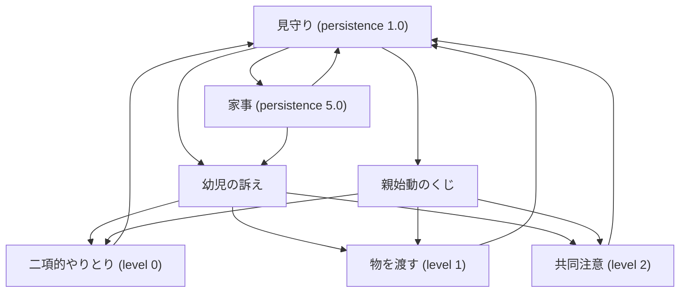
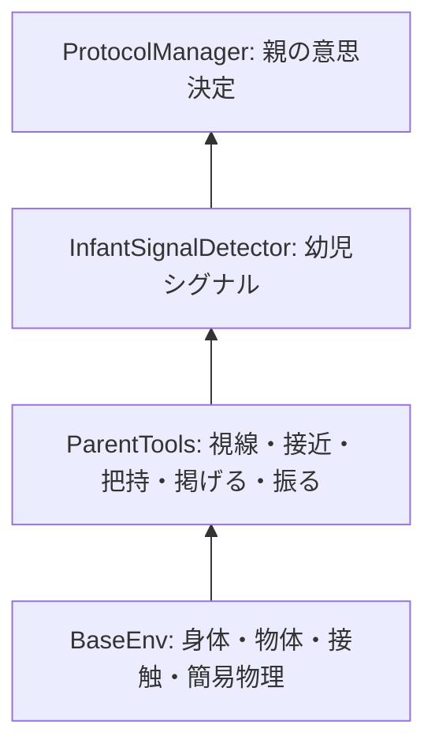

# CueWorld — 親子の社会的インタラクションを構成論的に扱う 3D 環境

本ドキュメントは、CueWorld を初めて見る人に向けた**外部発表用の概要**である。
部屋の中で親と幼児が何をしているのかを具体的に描いたうえで、その振る舞いがどの仕組みから出てくるのかを一通り説明する。これ 1 本で全体像が掴めるように書いてあり、実装の細部を追うときは各節からリンクしている仕様書（正本）へ進めばよい。

---

## 1. この環境は何をするか

CueWorld は PyBullet 上に作られた Gymnasium 準拠の 3D 環境で、**親（大人）と幼児（子ども）の社会的インタラクション**を扱う。

- **学習の主体は幼児**である。環境の `step()` に渡すのは幼児の行動で、観測も幼児のものだけを返す。
- **親はスクリプト再生ではない。** 幼児の視線・身振り・声を環境が数値シグナルへ変換し、親はそれを読んで「いま何をするか」を自分で決め、部屋の中を歩いて物を取り、幼児に応答する。
- ただし親は機械学習モデルでも LLM でもない。**確率的な条件分岐を組み合わせたオートマトン的な制御器**であり、遊びの種類ごとに 1 つの有限状態機械（FSM）を持ち、その上に「どの遊びをいつ始めるか」を決めるくじが載っている。振る舞いは追跡可能で、再現もできる。

この環境の中心にあるのは次のパイプラインである。

```
幼児の身体 → シグナル（視線・身振り・声） → 訴えの解釈 → 親の意思決定 → 親の身体動作 → 幼児の観測
```

発達研究の側から見ると、要点は**親が常時関わり続けるわけではない**ことである。親は幼児を見守り、家事に没頭し、幼児の訴えに応じ、ときには自分から遊びを持ちかける。関わりはスパースで、幼児の状態に依存して発生する。

強化学習・身体性 AI の側から見ると、要点は**環境そのものが応答的な他者を含む**ことである。幼児が同じ関節を同じ順で動かしても、親の状態が違えば返ってくるものが違う。親の行動は Wrapper 側で決まり、次の `step()` で環境に入る。

---

## 2. 部屋を上から見る

風景はかなり単純に固定してある。まずここを具体的に押さえると、以降の話が読みやすい。

- **アリーナ**は矩形の床と四方の壁。既定の半長は `(2.5, 2.0)` m なので、**およそ 5 m × 4 m の部屋**。
- **エージェントは 2 体**。親も幼児も同じ URDF 寸法のヒューマノイドで、見た目は胴体の色で区別する。腕は**片腕（左腕）のみ**。向きを変えるのは腰のヨー関節で、**前進はできるが後退はできない**。
- **物体**は 4 色（赤・青・緑・黄）× 4 形（立方体・球・円柱・円錐）の**可動プリミティブ 16 クラス**と、壁沿いに置く**ボード 5 クラス**（4 色のカラーボード＋色なしの汎用ボード）。可動物は 1 辺 12 cm 程度の小物で、幼児でも掴める大きさにしてある。
- 毎エピソード、プールの中から `num_objects` 個（既定 3）がアクティブになって床に置かれる。残りは画面外へ退避し、把持・接触・視線の対象にならない。
- **時間の単位は step**。設計上 **1 step ≒ 人間の約 0.1 秒**で、タイムアウトも遊びの長さもすべて step 数で持つ。幼児には眠気カウンタがあり、上限（`sleepiness_steps`、既定 100000 step）に達するとエピソードが終わる。眠気は正規化されて観測にも入る。

上から見た配置（グリッド配置の既定 3 行 × 4 列）。

```
                              +Y ↑

        col=0       col=1       col=2       col=3
      (x≈-1.88)   (x≈-0.63)   (x≈+0.63)   (x≈+1.88)
     ┌───────────┬───────────┬───────────┬───────────┐   ← 壁 (y = +2.0)
r=2  │           │           │           │           │  予約行
     │           │           │           │           │  （固定物専用。ボードなど）
     ├───────────┼───────────┼───────────┼───────────┤
r=1  │   幼児    │    物     │    物     │    親     │  中間行
     │           │           │           │           │  （親子と可動物の配置候補）
     ├───────────┼───────────┼───────────┼───────────┤
r=0  │           │           │           │           │  予約行
     │           │           │           │           │  （固定物専用）
     └───────────┴───────────┴───────────┴───────────┘   ← 壁 (y = -2.0)
      x = -2.5                                x = +2.5

                              -Y ↓

  playable 矩形: x ∈ [-2.5, +2.5], y ∈ [-2.0, +2.0]（既定）
  セル 1.25 m × 1.33 m / 部屋の対角 ≈ 6.40 m
```

親子と物は中間行のセルに散らばり、固定物（カラーボード）は上下の予約行や壁沿いに置く。「幼児の隣に赤い立方体があり、少し離れたところに親が立っていて、壁際に赤いボードがある」——これがいちばん典型的な初期状態である。

配置方式は 3 つ（グリッド / ランダム / 幾何制約つき）から選べる。詳細は [position.md](position.md)、物体の属性と寸法は [object.md](object.md)。

---

## 3. 1 エピソードで起きること

親の振る舞いは **5 つのプロトコル**（遊び・行動の型）として実装されている。親は常にそのうち 1 本を走らせていて、既定は「見守り」から始まる。以下は、それぞれが実際にどんな場面になるかである。条件分岐の状態遷移図は [protocol/automata/](protocol/automata/README.md)。

### 見守り（observance）

親は立ったまま**幼児の顔に視線を向け続け、腕を初期姿勢へ戻す**。それだけ。終了条件を持たないので、別のプロトコルへ切り替わるまで続く。

これは「親が手を空けて待っている状態」であり、後述の割り込みの重みが最も低く設定されている。幼児が何か信号を出せば、親は迷わず別の遊びへ移る。

正本: [protocol/observance.md](protocol/observance.md)

### 家事（household_solo）

親は幼児を相手にせず、**色の合う物をボードへ運ぶ**。家事中は一言も喋らない。

1. いま成立する「色 → ボード → その色の物」の組み合わせから 1 つ選ぶ
2. 運ぶ物を、**親からの距離**とその形の**典型性**（立方体 1.0、球 0.85、円柱 0.8、円錐 0.75）で重み付けした softmax で確率的に選ぶ
3. その物へ歩いて近づき、腕を伸ばして掴む
4. 対応する色のボードへ歩き、ボード中央の上へ手を伸ばして指を開く。物は落ちてボードに載る
5. 1 個載せたら終了（1 回の起動で運ぶのは 1 個）

このプロトコルの役割は、**親が別のことに集中している状況を作ること**である。幼児の側から見れば「親がこちらを見ていないときに、どうやって注意を引くか」という問題になる。家事は割り込まれにくく設定されているので、弱い信号では中断しない。

正本: [protocol/household_solo.md](protocol/household_solo.md)

### 二項的やりとり（dyadic）

**物を使わない、親子 2 者だけのリズムの交換**。模倣がその内容になる。やりとりの単位を「チャネル」と呼び、3 本ある。

| チャネル | 幼児側 | 親側の動作 |
|----------|--------|-----------|
| `voice` | 喃語を出している | 幼児が出していた音素を反復発声する |
| `arm_raise` | 手を目線の高さまで挙げている | 手を目線の高さに掲げる（＋親始動なら腕を振る） |
| `hand_open_close` | 手の開閉を繰り返している | 掲げた手で指の開閉を繰り返す |

- **幼児始動**なら、親は幼児が出しているチャネルを検出して真似る。声なら幼児が出していた音素をそのまま返す。
- **親始動**なら、親が先に 2 チャネル分の合図を見せ（半分は「声＋動き 1 本」、半分は「動き 2 本」）、幼児の反応を待つ。反応があれば「すごいね」と言って終わる。

モータチャネルの 1 周期は 30 step（≒3 秒）で、腕上げは 3 周期、開閉は 2 周期続く。応答待ちは 50 step（≒5 秒）で、1 度は「ねえ」と促してやり直す。成功 1 回の典型長は 105 step（≒10 秒）。

設計上の要点が 2 つある。ひとつは、**声のチャネルは「単語らしさ」で減点される**こと（喃語らしさ × 声量 ×（1 − 単語としての尖り））。二項的やりとりが対象にするのは意味のある単語ではなく、まだ単語になっていない発声である。もうひとつは、**手の開閉は手を挙げていなければ数えない**こと。下ろした手の開閉は親から見えないので、見えないものは模倣しない。

正本: [protocol/dyadic.md](protocol/dyadic.md)

### 物を渡す（object_giving）

**幼児が自分では届かない物を欲しがったときの遊び。** 幼児が遠くの物へ手を伸ばす、あるいはその名前を言うと、親が取ってきて幼児の手元に置く。

1. 対象の物へ歩き、腕を伸ばして掴む
2. 幼児のところまで運ぶ（運搬中は毎 step 握り直して落とさないようにする）
3. 「どうぞ ＋ 対象語」と言いながら、**親子を結ぶ線上・幼児側の点**へ手を伸ばし、指を開いて置く
4. 置いた物が幼児の到達圏に入っていることを確認して、幼児が拾うのを待つ
5. 幼児が持ち上げたら「すごいね ＋ 対象語」と言って終わる

手から手へ渡すのではなく**幼児の到達圏に置く**のがこの世界のやり方で、最後の一手（拾う）は必ず幼児側に残る。

待っても拾われない場合には梯子がある。34 step（≒3.4 秒）ごとに、まず**言い直し**（「ほら、どうぞ」）、次に**エスカレート**——置いた物を拾い直し、今度は幼児の目の高さに**掲げて見せてから**置く。それでも駄目なら**対象を変える**、最後に諦める。成功 1 回の典型長は 175 step（≒17.5 秒）で、カタログ中で最長である。

正本: [protocol/object_giving.md](protocol/object_giving.md)

### 共同注意（joint_attention）

**親が物を指定し、幼児がその物を見るまで**の三項関係。挙動は独立した 2 軸で決まる。

- **どうやって注意を向けさせるか**: 対象を見るだけ / 指差しながら見る / 取りに行って掴み、幼児の前で掲げて見せる（手首は振らない）
- **何のために向けさせるか**: 名前を教える（「これ ＋ 対象語」）/ 感情を共有する（「すごいね」）/ 何も言わない

成功判定は**視線だけ**で行う。幼児が対象を **30 step（3 秒）途切れずに**見たら成功。ここに 1 つ工夫が入っていて、**幼児が親の顔を見ている間はカウントを据え置く**。共同注意では対象と親の顔を交互に見るのが自然な振る舞いなので、それを離脱と数えてはいけない。対象以外を見たままの離脱が 50 step（5 秒）続いたらタイムアウトになる。

タイムアウトすると親は合図を 1 段強める。**「見るだけ」→「指差す」**という梯子がここにある。対象は変えない。

幼児が何か喋った場合、親は 1 回だけ反応する。対象の概念と一致していれば「すごいね ＋ 対象語」、近ければ「そうだね ＋ 対象語」、外れていれば「ちがうよ ＋ 対象語」。ただし**成功するかどうかは視線だけで決まる**。言い間違いを直すことと、共同注意が成立したかは別だという設計である。

成功 1 回の典型長は 130 step（≒13 秒）。

正本: [protocol/joint_attention.md](protocol/joint_attention.md)

### 親はこの 5 本をどう行き来するか



判定は毎 step ではなく、既定 **10 step（≒1 秒）ごと**に行う。親が幼児の様子を見て考え直す間隔にあたる。走っているプロトコルの動作自体は毎 step 進む。

判定には優先順位がある。

1. **幼児の訴えによる割り込み**（幼児始動）
2. 見守り中に限り、**家事の時計**
3. それでも何も起きなければ、見守り中に限り**親始動**

つまり**幼児の訴えが家事より優先**され、**関わりの最中には家事も親始動も割り込まない**。切り替えは決定的ではなく、「いまのプロトコルを維持する」という選択肢を含む softmax のくじで選ぶ。同じ状況でも親が毎回同じ反応をしないようにするためである。維持の重みは各プロトコルが返す `persistence` で、見守り 1.0、家事 5.0、関わりの 3 本は「幼児が乗っているか」に応じて 2.7 か 5.0 の 2 値をとる。

**親始動**（見守り中に、親が自分から持ちかける経路）には 2 つの特徴がある。

- くじが 2 段構えで、「始めるか待つか」と「何を始めるか」を分けている。候補の数が増えても開始の頻度が変わらない。既定値では、手がかりが何も無ければ約 3 分に 1 回、手がかりがあれば約 30 秒に 1 回の頻度で始まる。
- **幼児が自分から訴えて成功する割合が上がるほど、親は自分から始めなくなる**（待機スコアが上がる）。幼児が要求できるようになったら親は引く、という「待つ行動の創発」がここに入っている。
- どの遊びを選ぶかは**発達の最近接領域**の考え方で決まる。レベルごとの成功率 `s` から `s × (1 - s)`（成功率 0.5 で最大）を計算し、「半分くらいできるレベル」の 1 つ上までを候補にする。二項的やりとりが level 0、物を渡すが level 1、共同注意が level 2 である。

さらに、失敗直後のプロトコルはしばらく選ばれにくくなり（ペナルティ）、**同じ遊びを同じ物で 3 回続けて成功すると、その組み合わせが一度除外される**（飽き）。除外されるのは親の選択肢だけで、幼児のシグナルは何もマスクされない。

正本: [protocol_manager.md](protocol_manager.md)、共通契約は [protocol/README.md](protocol/README.md)

---

## 4. 親はどう「訴え」を読むか

ここからが仕組みである。環境は下から順に Wrapper を重ねて構成されている。



重要なのは**情報の流れが層で仕切られている**ことである。

- 親は関節角や物体 ID を直接読まない。`InfantSignalDetector` が作る**シグナル辞書だけ**を見る。
- プロトコルは「どの物へ近づき、掴み、掲げ、振るか」だけを決める。関節をどう動かすかは書かない。`ParentTools` のツール（視線を向ける、近づく、掴む、置く、掲げる、振る）を呼んで行動ベクトルに書き込むだけで、ツール群は「目標角 − 現在角」の残差を書くので、飽和つきの P 制御のように振る舞う。遠ければ最大速度で、近づけば自然に減速する。

### 何に向いているか（円錐レイキャスト）

視線・指差し・リーチ・腕の向きは、すべて同じ仕組みで「何に向いているか」に変換される。起点から前方へ、**中心 1 本 + 3° リング 4 本 + 8° リング 8 本の計 13 本**のレイを飛ばし、当たった対象ごとに角度に応じた確度（中心 1.0、3° 0.625、8° 0.25）を与える。結果は「全物体 ＋ 親」と同じ並びの確度ベクトルになる。

起点と方向はモダリティで変わる（視線は目、リーチは手のひら、指差しは人差し指の先、それ以外の手形は前腕）。手が掴める位置に物があるときは、レイを飛ばさずその物に確度が立つ。

ここに 2 つの解釈規則が入っている。ひとつは、**親が物を持っているときに幼児が親の手元を見ていれば「その物を見ている」と数える**こと。もうひとつは、親の胴や肩に当たっただけでは「親を見ている」にしないこと（顔のリンクに当たったときだけ親に帰属する）。

### 絞れているか（安定性）

「手の向きが定まっているか」「1 つの語に絞れているか」は、**分布の正規化エントロピーの補数**として [0, 1] で表す（1 つに集中していれば 1、散らばっていれば 0）。手と視線は瞬間値ではなく**直近 30 step（≒3 秒）の平均分布**に対して計算する。

シグナルの時間方向の畳み込み（履歴平均・ヒット率・周期性）は検出器側に集約されていて、読み手（親）は閾値をかけるだけである。読み手が窓の上に窓を重ねることは禁じてある。

正本: [infant_signal.md](infant_signal.md)

### 部品ではなく「訴え」で判断する（意図レイヤ）

親は原子シグナルを直接重み付き和にはしない。その手前に**意図レイヤ**があり、**部品が揃って初めて 1 になる AND 条件**として 5 つの 0/1 を作る。

| 訴え | 成立条件 |
|------|----------|
| `pointing`（揃った指差し） | 手の形が指差し かつ 手の対象がはっきりしている |
| `reach`（揃ったリーチ） | 手の形が開き手 かつ 何も持っていない かつ 手の対象がはっきりしている |
| `weak_arm`（弱い腕） | 何も持っていない かつ 手の対象がはっきりしている（手の形は問わない） |
| `word`（単語の訴え） | いま声が出ていて、単語分布が尖っていて、既知語に十分近い |
| `dyadic`（二項的な働きかけ） | 3 チャネルのいずれかが閾値以上 |

「手の対象がはっきりしている」は、**時間方向**（手の向きの安定性が 0.6 以上）と**空間方向**（特定の物にレイが集中している）の両方を要求する。片方だけでは、腕を振り回しているだけで対象を指したことになってしまう。

このレイヤを挟む理由は明快である。原子シグナルをそのまま足すと、手の安定度・声量・腕の伸びがばらばらに足し込まれて、**「どれも中途半端だが合計は大きい」という状態で遊びが始まってしまう**。

`weak_arm` は「形は未熟だが方向は示している」段階を拾うための薄い訴えで、指差しやリーチが立つときは必然的にこれも立つ。

### 訴えから遊びへ

親は 5 次元の 0/1 に重みを掛けて、プロトコルごとのスコアを作る。

| プロトコル | `pointing` | `reach` | `weak_arm` | `word` | `dyadic` |
|-----------|-----------|--------|-----------|-------|---------|
| 共同注意 | 2.0 | – | 0.3 | – | – |
| 物を渡す | – | 2.0 | 0.3 | 2.0 | – |
| 二項的やりとり | – | – | – | – | 2.0 |

完成形（指差し・リーチ・単語・二項）は 2.0 で、くじの温度に対して十分大きい。**弱い腕の 0.3 は、完成形が何も無いときだけ効く**薄い重みである。

さらに、環境の事実を使って訴えを落とすゲートがある。ここは「親がどう解釈するか」がそのまま出ている部分である。

- **場に無い物の名前**を言っても訴えにしない（渡しようがない）
- **自分の到達圏内にある物**への「くれ」やリーチは訴えにしない（自分で取れる物を要求とは読まない）
- **何か持っている**ならリーチではない（手が塞がっている）
- **揃った指差しが立っているとき**は、同時に喋っていても「くれ」ではなく共同注意の訴えと読む

物への訴えがあるときは物の遊びを優先し、物の遊びが選べない状況では二項が残る、という順序付けも入っている。

正本: [intent.md](intent.md)

---

## 5. 幼児の行動と観測

### 行動

1 エージェントの行動は **17 次元の連続値** `[-1, 1]` で、身体の各部位に 1 対 1 で対応する。

| 部位 | 次元 |
|------|------|
| 腰ヨー（向き変え）、首ヨー、首ピッチ | 3 |
| 肩ヨー、肩ピッチ、肘、手首ロール、手首ピッチ | 5 |
| 人差し指、その他の指（親指・小指） | 2 |
| 唇 | 1 |
| 前進（正の値のときだけ有効） | 1 |
| 発声: 音量、ピッチ、音素の識別軸 3 本 | 5 |

**各値は目標角度ではなく「1 step あたりの変位」の係数**で、実際の変位は `|action| × step_size`。この step 幅は親と幼児で別に持っており、**幼児のほうが小さい**（発達的に遅い動きが初期値になっている）。オプションで幼児の行動ベクトルだけを 3 乗し、小さな入力をさらに小さくすることもできる。

幼児は制御する次元を制限できる（例: 首と肩だけ動かす構成）。親は常にフル次元。

### 観測

観測は**幼児のものだけ**を返す辞書である（親側の観測は返さない）。

| キー | 中身 |
|------|------|
| `image` | 幼児の目から見た RGB 画像（既定 64 × 64） |
| `infant_voice` / `parent_voice` | 自分と親の発声ベクトル（音量・ピッチ・音素軸 3 本） |
| `parent_position` | 幼児から見た親の相対位置 |
| `object_sound` / `object_effect` | 物を振ったときに立つ 2 チャネル |
| `joint_angles` | 自分の関節角（13 次元。自己受容） |
| `tactile` / `holding` | 手が掴める位置にある物の触覚ベクトルと、把持中かどうか |
| `sleepiness` | 眠気の進行 |
| `fatigue` / `fatigue_lock` | 部位ごとの疲労（オプション。既定は常に 0） |
| `is_first` / `is_terminal` | エピソード境界のフラグ |

**ゼロ化の条件が観測設計の中心にある。**

- 声は**音量が閾値（既定 0.25）未満なら全要素 0**。無声のときに音素軸だけが観測されることはない。
- `parent_position` は**親が声を出しているときだけ**中身が入る。親の位置を常時観測できるわけではない。**親を見つけるには、声を聞くか、実際に目を向けて画像に写す必要がある。**
- `object_sound` / `object_effect` は、その step で振る判定が立たなければ 0。
- `tactile` は、手が掴める範囲に物が無ければ 0。

疲労はオプション（既定オフ）で、有効にすると 10 チャネル（首・肩・肘・手首・指・唇・声）が独立に疲労を蓄積し、上限に達すると一定時間その部位の操作が効かなくなる。

`BaseEnv` 単体の報酬は常に 0 である。`InfantSignalDetector` を重ねると**選好報酬**が加わり、「物を持っていること」と「その step に親の目を見たこと」に応じて値が入る（物体側の `preference`、親側の `parent_preference`）。

正本: [env.md](env.md)

---

## 6. ことばと物の名前

CueWorld の「ことば」は、音響の細部を捨てて**離散的な識別**の問題として設計されている。

- **音素は `p0`〜`p7` の 8 種**。3 本の識別軸上の値 ±1 の組み合わせ、すなわち**立方体の 8 頂点**として定義されている。任意の 2 音素の距離が等しく（最小 2.0）散らばるので、「特定のペアだけ混同しやすい」ということが起きない。軸に調音的な意味はなく、純粋な識別軸である。
- **単語はすべて 5 音素の固定長**で、任意の 2 単語のハミング距離が 4 以上になるように選んである。長さを手がかりにできず、1〜2 音素を誤認識しても別の単語には化けにくい。
- 単語の名前空間は**物体と共通**である。物体の識別 ID（`red_cube` のような色 × 形の複合 ID）がそのまま語彙のキーになる。機能語（「これ」「どうぞ」「すごいね」など）も同じ表に並ぶ。
- **音量は有声・無声の判定にだけ使い、ピッチは韻律用で単語認識には使わない。**

### 親の発話

親はテンプレートで喋る。**1 テンプレートは最大 2 語**で、機能語が先、対象語が後（例: 「これ ＋ 赤い立方体」「どうぞ ＋ 赤い立方体」）。文法構造は扱わない。

送出は**1 step 1 音素フレーム**で進む。1 音素は 6 フレームなので、1 語で 30 step（≒3 秒）、2 語のテンプレートなら 61 step（≒6.1 秒）かかる。発話キューはプロトコルの状態遷移とは独立に消化されるので、**親は「すごいね」を言い切ってから遊びを終える**。この間は割り込みも保留されうる。

### 幼児の発声の認識

幼児が行動ベクトルの発声次元を動かすと、発声ベクトルが更新される（幼児側は積算、親側は毎 step 上書き）。認識は 2 段である。

1. **音素**: 発声ベクトルを 8 個のプロトタイプと比較し、最良のコストが十分小さく、かつ 2 位と十分な差があればそのラベル。満たさなければ「同定不能」。無声とは区別する。
2. **単語**: 無声が 4 フレーム続いたところで発話区間を切り、その音素列を辞書の各単語と DP マッチングする。置換コストは 0/1 の一致判定ではなく、**そのフレームで各音素がどれくらいありえたかの連続値**を使う。無声フレームの脱落と同じ音素の引き伸ばしはほぼ無料にしてある（1 音素が 6 フレーム持続するため）。最後に正規化スコア・生スコア・**系列品質**・2 位との差の 4 条件をすべて満たしたときだけ単語を返す。

系列品質は「音素として同定できたフレームの割合」を最も重く見る指標で、**喃語のように音素が定まらない発声は、たまたま DP スコアが低くても弾かれる**。単語と喃語の境界がここで決まり、その境界が第 3 節の「二項的やりとりは喃語を、受け渡しは単語を対象にする」に効いてくる。

正本: [language.md](language.md)

---

## 7. 身体と接触のルール

この世界の物理は「社会的やりとりのタイミングと解釈」を研究対象にするために、意図的に単純化してある。歩行制御や把持そのものの難しさは扱わない。

- **通常の `step()` では物理エンジンを進めない。** 移動は前進コマンドによるキネマティックなスライドで、アリーナ内へクリップされる。物体の落下だけを毎 step 手で処理する（転がり・跳ね返り・傾きは起きない）。したがって物が勝手に転がって共同注意が崩れることはない。
- **把持は手の形と距離で決まる。** 手のひらの周囲の一定距離に掴める物があり、手の形が**開き手から握りへ遷移した瞬間**に成立する。掴んだ物は手のひらの前方にスナップされ、指を開いた瞬間に離れる。離した位置がボードに重なっていれば「載せた」と記録される（家事の完了判定はこれ）。
- **到達圏は腕の長さから実測して決める。** URDF をロードした直後に床置きの掴み姿勢で順運動学を解き、その結果から「幼児が自分で取れる距離」「物を置く距離」「渡すために立つ距離」を派生させる。**「その物に自分で手が届くか」が明示的な述語になっている**のがこの環境の特徴で、受け渡しの成立条件も親の解釈ゲートもこれを読む。
- **受け渡しは手から手ではなく、相手の到達圏に置く。** 最後の一手は必ず受け取る側に残る。
- **物を振ると、音と効果の 2 チャネルが幼児の観測に立つ。** 判定は把持物の位置を**胴体ローカル座標**で見るので、歩いて移動しただけでは発火しない。値は**形が音、色が効果**に対応している（手がかりが色だけに偏らないよう、意図的に分けてある）。
- 触覚も同様に、色 × 形ごとに単位円上の一意なベクトルを割り当ててある。同じ形どうしは近く、別の形とは遠い。

そのほか設計として固定しているもの: **テーブルを置かない**（指差しと物を掴む動作が幾何的に区別しにくくなるため）、**腕は片腕のみ**（両手動作は扱わない）、**物体はプリミティブに限る**（4 形状で把持成功率に偏りがないことは実測済み）。

正本: [env.md](env.md)、[object.md](object.md)

---

## 8. 使い方の骨格

Wrapper を下から積んで使う。

```python
env = ProtocolManager(InfantSignalDetector(ParentTools(BaseEnv(...))))

obs, info = env.reset()
obs, reward, done, truncated, info = env.step(infant_action)

signals       = info["infant_signals"]   # 幼児シグナル辞書
parent_action = info["parent_action"]     # この step で親が決めた行動
```

`ProtocolManager` を重ねると、`step()` に渡すのは幼児の行動だけになる。親の行動はその step の中では環境に入らず、**呼び出し側が次の step で渡す**（`BaseEnv` 自体は常に「幼児と親」の 2 本組を受け取る）。親の遊びの履歴（成功・失敗・割り込み、対象、長さ、共同注意なら合図の種類と単語の当たり方）は `info` に載るので、評価スクリプトはこれを読む。

用途に応じて構成を変えられる。

- **プロトコルを固定する**モードがあり、切り替え判定を飛ばして 1 本だけを走らせられる。デモと評価向け。対象の物も固定できる。
- **親を外す**こともできる（エージェント 1 体の構成）。幼児だけの部屋になり、物の操作と探索だけが残る。
- 下の層だけを積んで使ってもよい。`BaseEnv` は身体と物理の保証だけを持ち、幼児の行動の解釈・親の意思決定・遊びの進行はすべて上の Wrapper 側にある。

---

## 9. 仕様の正本

本ドキュメントは概要であり、値と契約の正本は以下にある（下から上へ）。

| ドキュメント | 対象 |
|-------------|------|
| [env.md](env.md) | `BaseEnv`。座標系・行動空間・観測空間・接触と把持・`step()` の処理順 |
| [object.md](object.md) | 物体の識別属性・寸法・アフォーダンス |
| [position.md](position.md) | 初期配置の方式とパラメータ |
| [language.md](language.md) | 音素・語彙・発話テンプレート・音声認識 |
| [parent_tools.md](parent_tools.md) | 親の行動生成ツール（視線・移動・腕・掲げる・振る） |
| [infant_signal.md](infant_signal.md) | 幼児シグナルの原子キーとその定義 |
| [intent.md](intent.md) | 原子シグナルから合成する訴えの 0/1 セット |
| [protocol/README.md](protocol/README.md) | プロトコル共通契約。個別 5 本への入口 |
| [protocol/automata/](protocol/automata/README.md) | 各プロトコルと切り替え判定の状態遷移図 |
| [protocol_manager.md](protocol_manager.md) | 親の意思決定。切り替え・親始動・学習の記録 |
