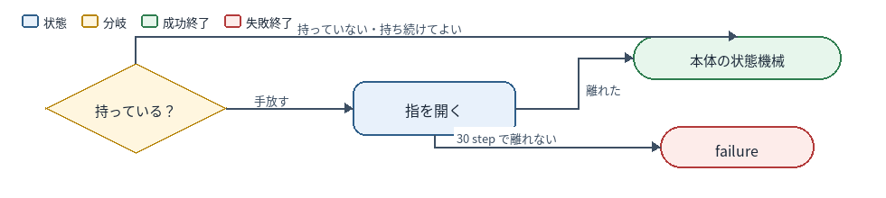

# プロトコルのオートマトン図

各プロトコルの**条件分岐だけ**を状態遷移図にしたもの。値・契約・注意事項の正本はリンク先であり、このディレクトリは図である。

| 図 | 正本 |
|----|------|
| [observance.md](observance.md) | [../observance.md](../observance.md) |
| [household_solo.md](household_solo.md) | [../household_solo.md](../household_solo.md) |
| [dyadic.md](dyadic.md) | [../dyadic.md](../dyadic.md) |
| [object_giving.md](object_giving.md) | [../object_giving.md](../object_giving.md) |
| [joint_attention.md](joint_attention.md) | [../joint_attention.md](../joint_attention.md) |
| [protocol_manager.md](protocol_manager.md) | [../../protocol_manager.md](../../protocol_manager.md) |

最後の 1 本はプロトコル内部ではなく、**5 本のあいだを行き来する外側の判定**である。

図は `protocols/*.py` の `_manage_state`（マネージャは `update`）に合わせてある。概要の接続図（[../../overview.md](../../overview.md) §3）より分岐が細かい。

---

## 読み方

- 青の角丸が状態、黄色のひし形がその step で分かれる分岐、緑が成功終了、赤が失敗終了である。矢印の文字がガード。
- 終了状態に入っても、発話キューが残っているあいだは `is_finished` にならない（[../README.md §1](../README.md#1-インターフェース)）。拒否とモータのエラータイムアウトはキューを捨てて即終了する。
- `retry_count` は状態遷移ではリセットされない。梯子はプロトコル 1 回の通算である。

### 開始時の手放し

`uses_pre_release = True`（見守り以外の既定）で、親が物を持っていて `keeps_held_object` が偽なら、本体の状態機械に入る前にここを通る。

この失敗は除外リストに入らない。各図の「持ち続ける物」はプロトコル側の例外である。
