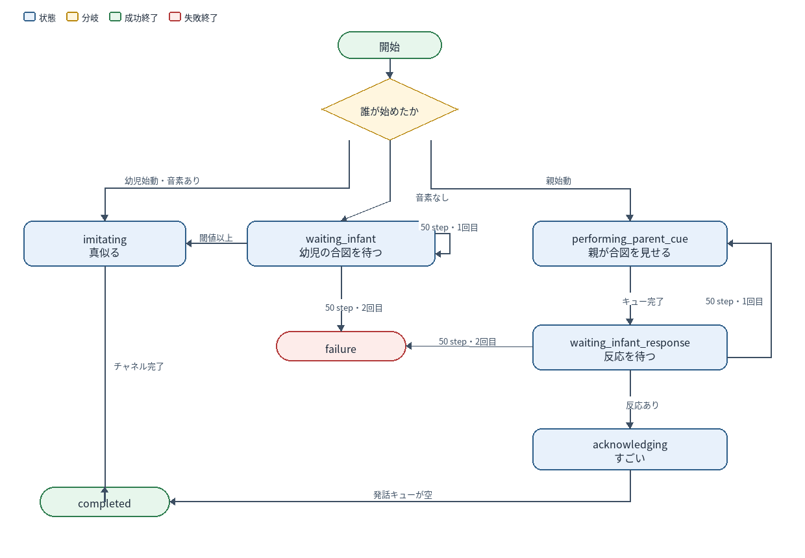

# 二項的やりとり — 状態遷移

正本: [../dyadic.md](../dyadic.md)

入口は `infant_initiative` で分かれる。どの状態にいても、拒否が立てば発話とモータを捨てて `failure`（拒否の中身は [../README.md §7](../README.md#7-拒否検知)）。物は持たないので、開始時に持っていれば [README.md](README.md) の手放しを通る。

`vocalizing` は遷移表に残っているが、入る箇所が無い。`voice` は `performing_parent_cue` の中で処理する。

拒否は上のすべての状態から `failure` へ出る。図では省略している。

## 入口とチャネル

| 経路 | キューの決まり方 |
|------|------------------|
| 幼児始動 + `target_phoneme` | `waiting_infant` を飛ばし、その音素の `voice` だけを真似る |
| 幼児始動 | τ を超えたチャネルを固定順（voice → arm_raise → hand_open_close）で全部真似る |
| 親始動 | 50% が「声 + モータ 1 本」、50% が「モータ 2 本」。`context["parent_channels"]` で固定できる |

`hand_open_close` だけは存在しない。入っていれば `arm_raise` を前に足す。

| チャネル | τ | 親の動作が終わる条件 |
|----------|---|----------------------|
| `voice` | 0.2 | 音素 30 + 無音 15 を 2 回（90 フレーム） |
| `arm_raise` | 0.8 | 90 step。幼児始動は掲げるだけ、親始動は加えて振る |
| `hand_open_close` | 0.2 | 60 step。手を挙げているときだけ salience を数える |

腕チャネルは掲げ位置へ届くまでタイマーを進めない。20 step で強制的に到達扱いにする。

## 待ちと反応

`handle_timeout(max_retries=1)` なので 1 回目が `RETRY`、2 回目が `FAILED`。`ESCALATE` と `CHANGE_TARGET` は返っても失敗に落とす。

親始動の反応（`_detect_infant_response`）は次のどちらか。見せたチャネルとの一致は要らない。

- `babbling_target` が付いている
- どれか 1 チャネルの salience が自分の τ 以上

RETRY の親始動はチャネルを引き直して `performing_parent_cue` からやり直す。幼児始動の RETRY は「ねえ」をキューして同じ `waiting_infant` に留まる。

## 状態を変えない条件

| 条件 | 効果 |
|------|------|
| `waiting_infant_response` 以降の salience ピーク | `response_matched` の注釈だけ。成否は変えない |
| `imitating` / `acknowledging`、または反応検出 | `infant_is_engaged`。persistence が 5.0 になる側 |
| 幼児が発話区間の途中、または `acknowledging` で発話が残っている | `blocks_interrupt`。PM は割り込みくじを引かない |
