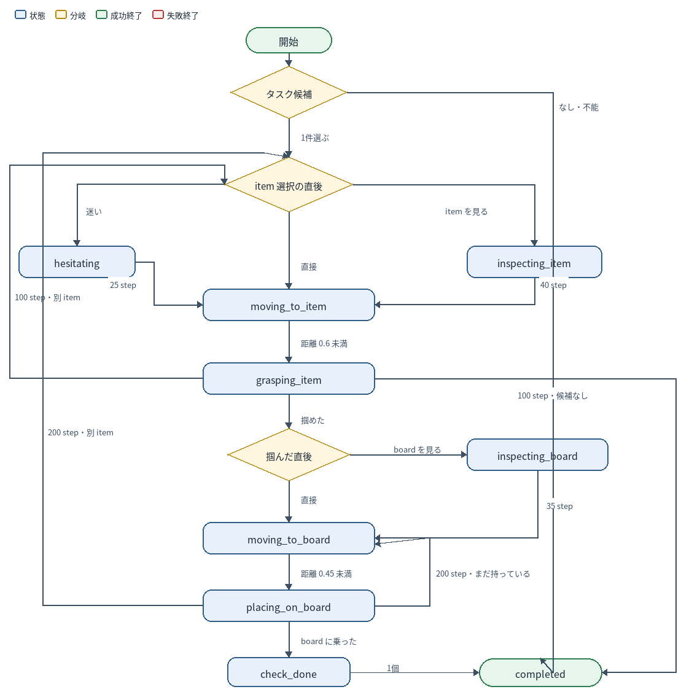

# 家事 — 状態遷移

正本: [../household_solo.md](../household_solo.md)

幼児の拒否では分岐しない。発話もしない。`persistence` は常に 5.0。運んでいる item そのものは開始時に手放さない（[README.md](README.md) の手放し）。

候補が尽きる再選択（掴み失敗・載せ失敗）も、最初の item 選択と同じ分岐に戻る。残候補が空なら `completed`。

## 分岐の中身

| 分岐 | 条件 |
|------|------|
| タスク | 色ごとの board と、未配置・未把持の同色 item が両方ある組。`fixed_task` があればその `task_type` だけ。無指定なら一様ランダム |
| item | 距離と典型性（立方体 1.0 / 球 0.85 / 円柱 0.8 / 円錐 0.75）の softmax。`household_style` の既定は `committed` |
| 迷い / 見る | 判定順は hesitate → inspect。既定確率はすべて 0（オフ）。長さは迷い 25 / item 40 / board 35 step |
| 載せ失敗 | 200 step で乗らなければ、指を開いていれば別 item、持っていれば board へ戻る |

`check_done` は `items_placed` を 1 にして即 `completed`。候補が残っていても続けない。
