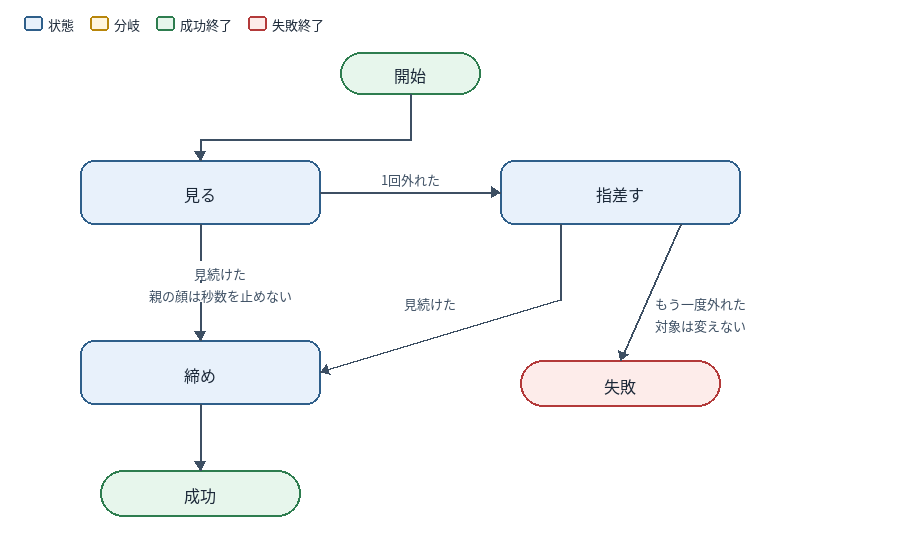
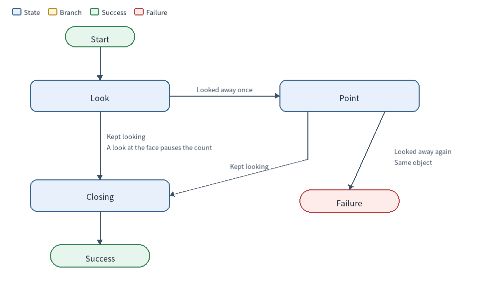
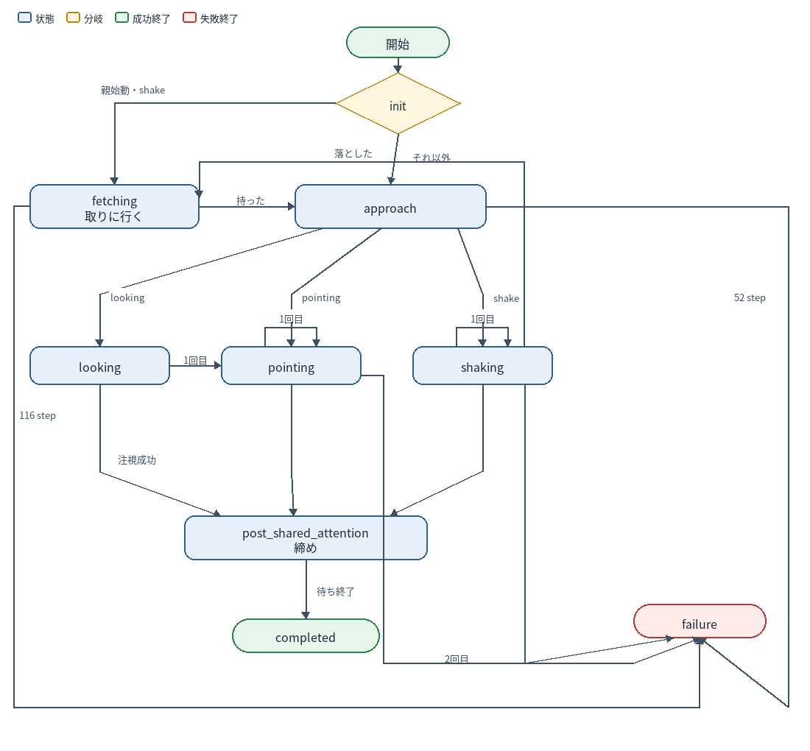
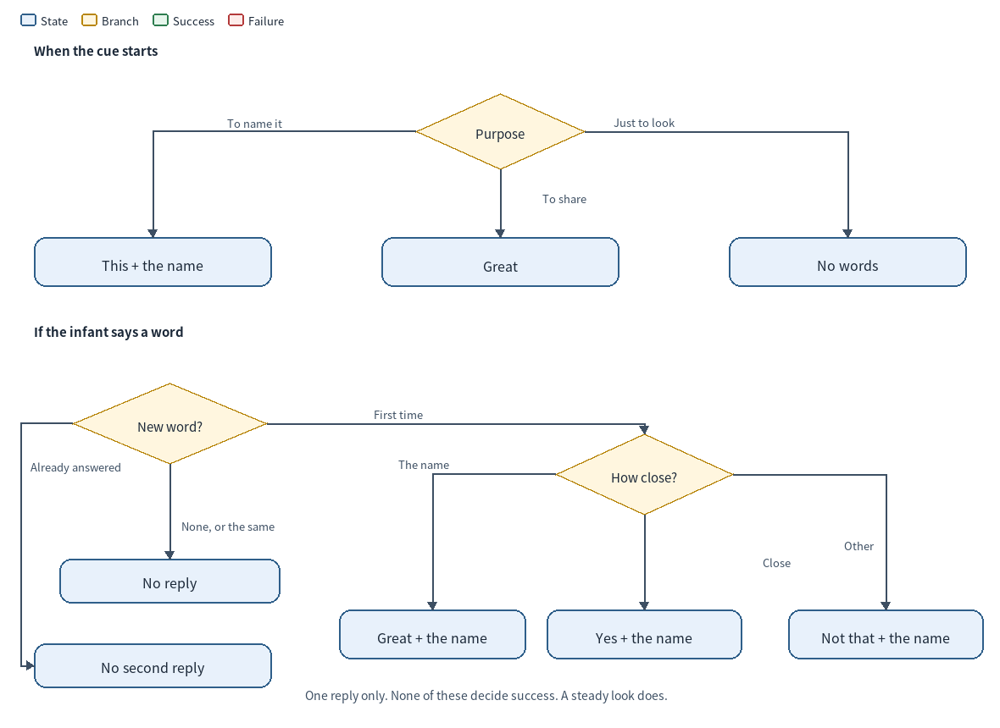
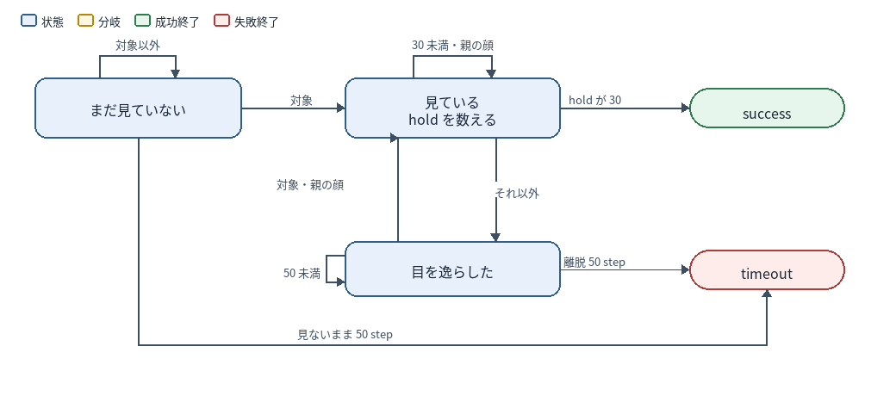

# 共同注意 — 状態遷移

正本: [../joint_attention.md](../joint_attention.md)

挙動は `cue_type`（どう向けるか）と `intent_type`（何を言うか）の 2 軸。カタログのインスタンスは `cue_type = "pointing"` で作られ、幼児始動の context は `intent_type = "informative"` を渡す。`context` で上書きできる。

`shake` で対象そのものを持っていれば開始時に手放さない。どの状態からでも拒否なら発話を捨てて `failure`。`fetching` / `approach` のタイムアウトはモータのエラーで、梯子に乗らず即 `failure`。タイムアウトで対象は変えない。

簡易版。見ることから始め、1 回外れたら指差す。見続けたら締めを経て成功し、指差しでも外れたら対象を変えずに失敗する。

詳細は下の図。

幼児始動の `shake` は `fetching` を通らず `approach` から入る。距離の判定はタイムアウトより先である。

`looking` の 1 回目は `cue_type` を `pointing` に変えて移る。2 回目の失敗は、そのあと `pointing` に居るときに出る。最初から `pointing` または `shake` なら、1 回目は同じ状態のまま発話し直し、2 回目で `failure`。`shaking` から `fetching` へ戻るときだけ注視トラッカーをリセットしない。

## 合図中の毎 step

1. 初回だけ発話をキューし、注視トラッカーをリセットする（`_cue_started`）
2. 単語が前回と変わっていれば 1 回だけ反応する（状態は変わらない）
3. 注視トラッカーを 1 step 進める

`intent_type` は 1 の発話だけを変える。

| `intent_type` | 発話 |
|---------------|------|
| `informative` | 「これ + 対象語」 |
| `sharing` | 「すごい」 |
| `simple` | 無し |

| 単語 | 発話 | 記録 |
|------|------|------|
| 対象の概念と一致 | 「すごい + 対象語」 | `correct` |
| 不一致かつスコア 2.0 未満 | 「そうだね + 対象語」 | `near` |
| それ以外 | 「ちがうよ + 対象語」 | `wrong` |

反応はホールド成立後だけ。1 まとまりにつき 1 回。成功フラグは視線だけで決まる。詳細は [../../joint_attention_session.md](../../joint_attention_session.md)。

成立前の 1 回目のタイムアウトは発話を再キューしてトラッカーをリセットする。`pointing` と `shake` は振るために取り直さない。成立後の離脱は合図を強めず成功のまま閉じる。

## 注視トラッカー

合図中と `post_shared_attention` で毎 step 呼ばれる内部状態。入力は幼児の視線対象。

親の顔を見ているあいだ hold は据え置く。一度も対象を見ていないときだけ、親の顔を見ていても 50 step の待ちが進む。

## セッション（`post_shared_attention`）

合図は続け、顔だけ幼児へ向ける。言葉の往復を最大 5 回。

| 条件 | 遷移 |
|------|------|
| キューが空で声区間の外、待ちが 50 step 以上 | `completed`（成功） |
| 声区間の中で、まだ単語反応がなく、待ちが 50 step 以上 | `completed`（成功） |
| 成立後に視線離脱が 50 step | `completed`（成功） |
| 5 往復目の返事を言い終える | `completed`（成功） |
| 声区間の中（上以外）または親が発話中 | 留まる |

## 状態を変えない条件

| 条件 | 効果 |
|------|------|
| 視線対象が今の対象と一致 | `infant_is_engaged`。3 秒ホールドとは独立 |
| `post_shared_attention` で、親の発話が残っているか幼児の声が出ている | `blocks_interrupt` |
