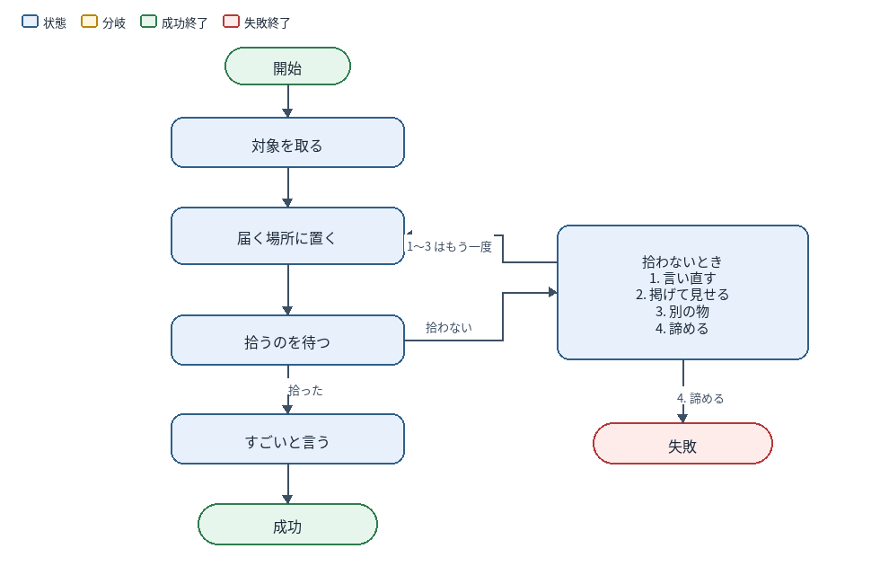
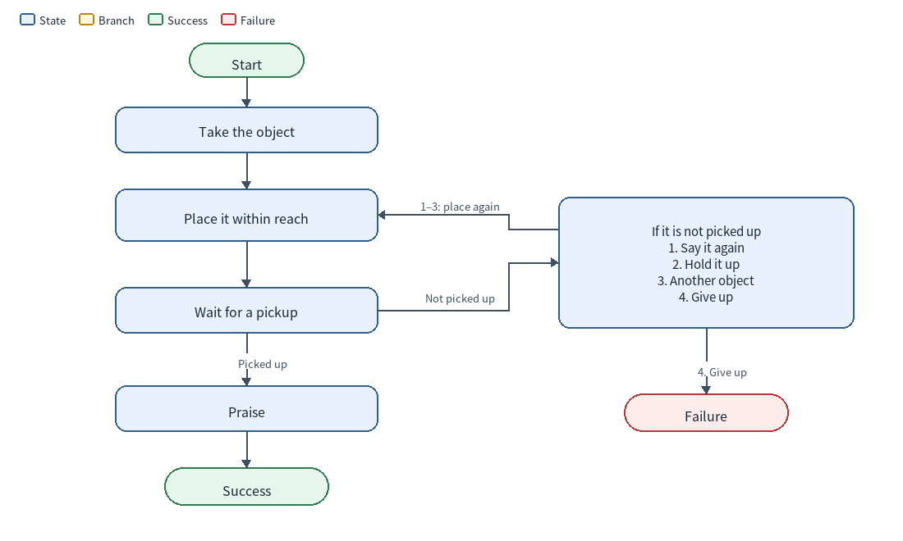
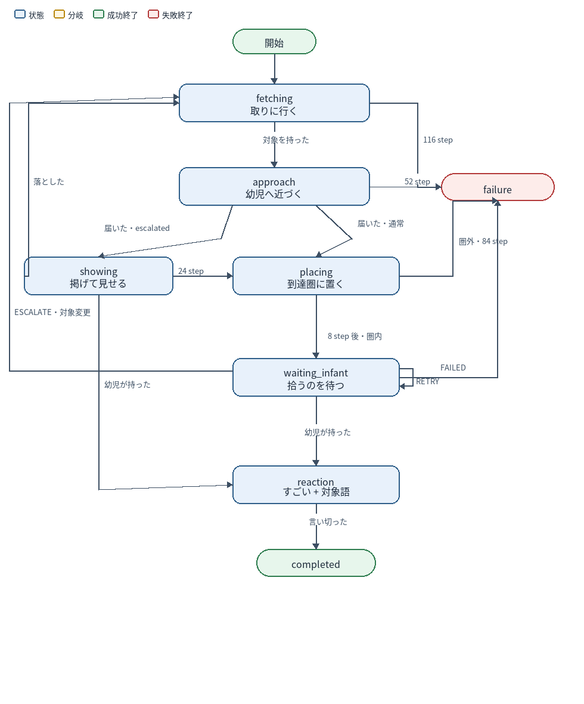

# 物を渡す — 状態遷移

正本: [../object_giving.md](../object_giving.md)

対象物そのものを開始時に持っていれば手放さない。どの状態からでも拒否なら発話を捨てて `failure`。モータが上限内に終わらない失敗（`fail_on_error_timeout`）は梯子に乗らず、その場で `failure`。

`retry_count` は状態をまたいで残る。`waiting_infant` の超過は 1 回目 RETRY、2 回目 ESCALATE、3 回目 CHANGE_TARGET、それ以降 FAILED。

簡易版。取って届く場所に置く。拾えば成功、拾わなければ梯子を 1 段ずつ進める。

詳細は下の図。

## 置き方の分岐

`approach` で幼児に十分近づいたとき、通常経路は置き点を計算して `placing` へ入り、「どうぞ + 対象語」をキューする。`escalated` なら掲げ点を計算して `showing` へ入り、同じ発話をキューする。

`showing` から `placing` へ戻るときは発話を重ねない。このとき `escalated` を下ろすので、次に置くときは通常経路である。落として `fetching` に戻ったときだけ `escalated` が残る。

`showing` の退出は上から順に、幼児が持った、親が落とした、`state_timer > 24` である。`show_min_steps = 30`（掲げ到達かつ 30 step）の枝はそのあとにある。24 のほうが小さいので、この枝には入らない。

`placing` で手放す前、幼児が 0.25 m 以上動いたら置き点を計算し直す。状態は変わらない。手放したあと 8 step 待ち、物と幼児の距離が `reach_radius + 0.03` を超えていれば待たずに失敗する。

## 待ちの梯子

`waiting_infant` だけが `handle_timeout(max_retries=3)` に乗る。間隔は 34 step。

| 通算 | 返り値 | 遷移 |
|------|--------|------|
| 1 | `RETRY` | 状態は維持。`present` を再キューし、タイマーを 0 に戻す |
| 2 | `ESCALATE` | `escalated = True` で `fetching`。拾い直して掲げてから置く |
| 3 | `CHANGE_TARGET` | `select_target` して `fetching` |
| 4 以降 | `FAILED` | `failure` |

## 状態を変えない条件

`infant_is_engaged` は、今の対象を見ている / 触っている / 持っているとき真。`blocks_interrupt` は常に偽なので、締めの発話中も割り込みくじは引ける。
