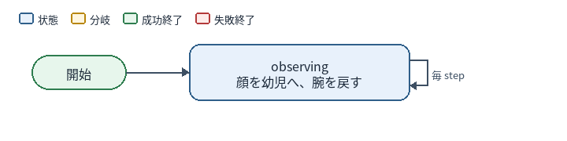

# 見守り — 状態遷移

正本: [../observance.md](../observance.md)

状態は 1 つで、終了辺が無い。別のプロトコルへ移るのは [protocol_manager.md](protocol_manager.md) の判定である。`uses_pre_release = False`。`persistence` は常に 1.0。

`observing` のあいだ、毎 step 顔を幼児へ向け、腕を初期姿勢へ戻す。幼児が遠くても近づかない。
