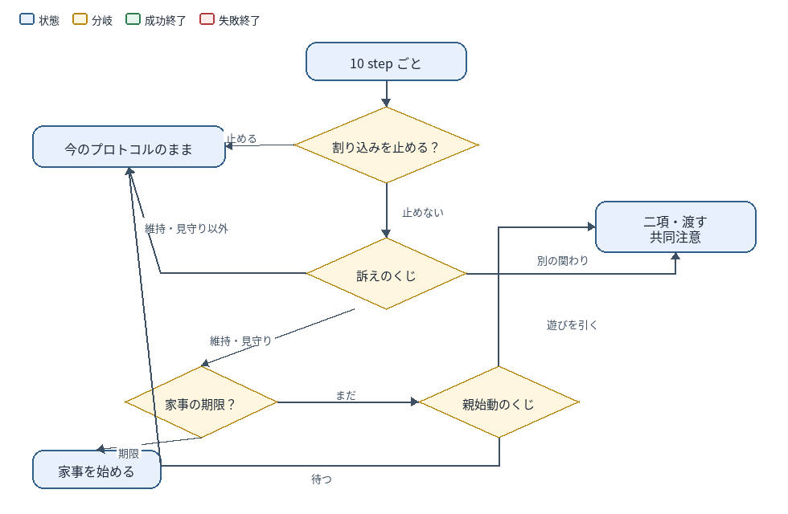
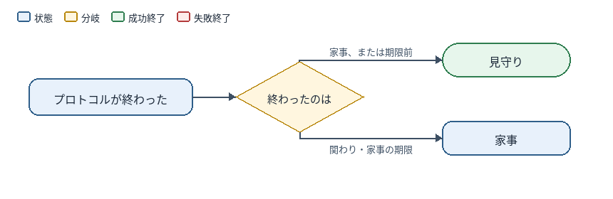

# プロトコルマネージャ — 切り替えの判定

正本: [../../protocol_manager.md](../../protocol_manager.md)

外側の状態は、いま走らせているプロトコルである。本体は毎 step 進み、**切り替えの判定は 10 step ごと**（`check_interval`）。`fixed_protocol` のときはこの図の辺を全部飛ばし、終わったらエピソードを終える。

`blocks_interrupt` が真の回は、どの状態からも出ない。訴えで移れる先は関わり 3 本だけである。家事と親始動の辺は見守りに居るときだけ引く。

維持（くじが今のプロトコルを残す）と `blocks_interrupt` の回は、矢印を出さずにその場に留まる。

終わったあとの行き先。家事の終了は、期限が来ていても見守りへ戻す。

見守り以外の関わりを割り込みで切ったときは、切られた側を `end_reason = "interrupt"` の失敗として履歴に積む。家事と見守りは積まない。家事が終わったときは時計を押し、期限が来ていても必ず見守りへ戻る。

## 判定の優先

1. `blocks_interrupt` が真なら、その回はくじを引かない
2. 幼児の訴え（`check_for_response`）。この経路は `infant_initiative = True`
3. 見守り中だけで、家事の時計
4. それでも見守りなら、親始動（`check_for_initiative`）。この経路は `infant_initiative = False`

関わりの実行中は 3 と 4 に入らない。

## 訴えのくじ

ゲート後の 0/1 に重みを掛け、プロトコルペナルティを引き、物の遊び（共同注意か物を渡す）のスコアが正なら二項を 0 にする。

| プロトコル | pointing | reach | weak_arm | word | dyadic |
|-----------|----------|-------|----------|------|--------|
| 共同注意 | 2.0 | – | 0.3 | – | – |
| 物を渡す | – | 2.0 | 0.3 | 2.0 | – |
| 二項的やりとり | – | – | – | – | 2.0 |

選択肢は `maintain` と上の 3 本。`maintain` のスコアは `persistence`（見守り 1.0、家事 5.0、関わりは 2.7 か 5.0）。温度 0.2 の softmax を 1 回引く。除外リストに掛かる見込み対象の選択肢は落としてから正規化する。

維持の 2 値（関わり 3 本。家事と見守りは固定値でこの表を使わない）:

| 上から順に最初に真 | persistence |
|--------------------|-------------|
| `retry_count` が 1 以上 | 2.7 |
| 幼児が乗っていない | 2.7 |
| 完成形の手が今の対象と同じ | 2.7 |
| どれでもない | 5.0 |

## 家事の時計

見守り中に訴えで切り替わらなかったときと、関わりが終わったとき（見守りを挟まない）に見る。

- 前回家事の完了から `household_interval_steps` 以上
- `household_task_candidates` が空でない

家事が終わると時計を押し、必ず見守りへ戻る。

## 親始動のくじ

見守り中だけ。2 段を掛けた結合分布から 1 回引く。

一段目は待つか始めるか。待機スコアは `1.04 + 幼児の自発性`、開始スコアは手がかりが 1 つでもあれば `0.36`、無ければ `0`。温度 0.2。自発性が上がるほど親は自分から始めない。

二段目は何を始めるか。候補は level が `max_level` 以下の関わり 3 本。物を渡すは、幼児が何も持っておらず届かない物が 1 つ以上あるときだけ残る。魅力度は `s(1-s)`（成功率 0.5 で最大）に手がかりとペナルティを足し引きしたもの。`max_level` は、その値が 0.1 以上の最大レベル + 1。

## 終了後に状態へ残るもの

| 出来事 | 次に効くもの |
|--------|----------------|
| 失敗終了 | そのプロトコルへペナルティ +2.0。判定ごとに 0.5 減衰 |
| 失敗終了（手放し失敗を除く） | （遊び, 物）を除外 |
| 同じ（遊び, 物）が 3 連続成功 | そのペアを除外 |
| 除外リストが空でないときの成功 | リストと連続カウントを全部消す |
| 幼児始動かつ成功 | 自発性の移動平均が上がる。親始動の成功は下げる |
