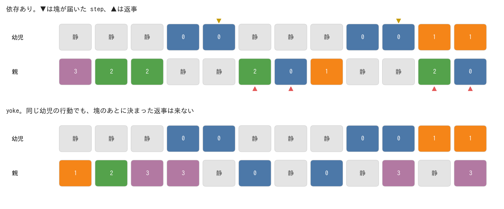
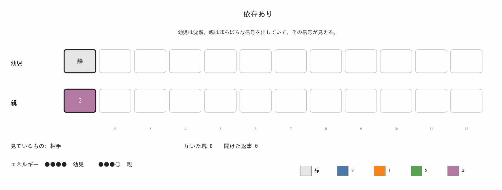

# コミュニケーション環境

`CommunicationEnv` は、幼児の信号の塊が親の返事を予測しやすくするかを見るための離散環境です。学習するエージェントは置きません。呼び出し側が `reset` / `step` します。報酬は常に 0 です。

正本のコードは `envs/communication.py`、確認は `tests/test_communication.py` です。動きの録画は `demo/communication_demo.gif`、全体の並びは `demo/communication_timeline.png` です。

## 何が見えるか

幼児も親も、毎 step「何もしない」か信号を 1 つ出します。信号は 4 種類です。

意味は、一人が続けて出した信号 2 つにあります。相手がその 2 step とも黙って受け取ったときだけ、その塊は相手に届きます。既定では、届く塊は `(0, 0)` だけです。届くと、次の 2 step で親は `(2, 0)` を返します。

幼児が黙っているあいだ、親は 4 記号をばらばらに出します。このあいだの観測は予測しにくいです。`(0, 0)` を出してから 2 step 黙ると、観測は `(2, 0)` に決まります。見たいのは、この差が幼児の行動から起きるかどうかです。

比べる条件は 2 つです。

- 依存あり。上の規則で親が返事をする。
- yoke。別のエピソードで記録した親の行動列を、いまの幼児の行動と無関係に再生する。受信も返事も作らない。

## 呼び出し

```python
from envs.communication import CommunicationEnv

env = CommunicationEnv(max_steps=100, n_meaningful=1, obs_noise=0.0, seed=0)
obs, info = env.reset()
obs, reward, terminated, truncated, info = env.step(action)
```

`reward` は常に 0、`terminated` は常に False です。`max_steps` に達すると `truncated` が True になり、そのあとの `step` はエラーです。

行動番号は次のとおりです。

| 行動 | 意味 |
| --- | --- |
| 0 | 何もしない |
| 1 | 記号 0 |
| 2 | 記号 1 |
| 3 | 記号 2 |
| 4 | 記号 3 |

`n_meaningful` は 1 以上 8 以下です。下の表の先頭からその個数だけが意味を持ちます。既定の 1 では 0 番だけが有効です。

| 番号 | トリガ | 返事 |
| --- | --- | --- |
| 0 | (0, 0) | (2, 0) |
| 1 | (0, 1) | (2, 1) |
| 2 | (0, 2) | (2, 2) |
| 3 | (0, 3) | (2, 3) |
| 4 | (1, 0) | (3, 0) |
| 5 | (1, 1) | (3, 1) |
| 6 | (1, 2) | (3, 2) |
| 7 | (1, 3) | (3, 3) |

この対応は seed で変わりません。表に入っていない 2 連続と、無効にした番号のトリガは意味なしです。

## 1 step の中

幼児の行動を先に解決します。エネルギーが 0 のときに信号を選ぶと、その step は何もしないになります。

親の行動は次の順で決まります。

1. yoke なら、渡された列のその step を出す。
2. 返事の再生中なら、返事の次の 1 文字を出す。幼児が同時に話しても中断しない。
3. 幼児が信号を出していれば、親は沈黙して受け取る。
4. 幼児が沈黙していれば、親は 4 記号から一様に 1 つ出す。親のエネルギーが 0 のときだけ沈黙する。

返事と同じ 2 連続は、このランダム期間にも確率 1/16 で出ます。禁止はしません。

受け取り中は、毎 step で直近の 2 信号を見ます。`(2, 0, 0)` のように、先頭が意味なしでも、続く `(0, 0)` は塊になります。あいだに何もしない step が入ると、そこまでの受信は切れます。

意味のある塊が届いた step で受信の履歴を空にし、次の 2 step を返事にします。返事のあいだに幼児が出した信号は受け取りません。次の塊には、返事が終わったあとの信号が 2 つ要ります。

届いた step の観測は、まだ幼児自身の信号です。返事はその次からです。

```text
step  幼児   親        幼児が見るもの
 1    記号0  沈黙      自分の 0
 2    記号0  沈黙      自分の 0     ← (0, 0) が届く
 3    沈黙   記号2     相手の 2     ← 返事の 1 文字目
 4    沈黙   記号0     相手の 0     ← 返事の 2 文字目
```

3 と 4 で幼児が信号を出すと、親の返事は出ますが、幼児の観測は自分の信号のままです。`reply_heard_count` は増えません。

## エネルギー

幼児も親も最大 4、初期値 4 です。何もしないは +1、信号は −1 です。4 を超えません。0 のときに信号を選ぶと何もしないになり、エネルギーは 1 に戻ります。

観測に入るのは幼児のエネルギーだけです。値は、その step の更新が終わったあとのエネルギーを 4 で割ったものです。`reset` 直後の観測は `[1, 0, 0, 0, 0, 0]` です。

## 観測

長さ 6 のベクトルです。

| 位置 | 中身 |
| --- | --- |
| 0 | 幼児のエネルギー / 4（0, 0.25, 0.5, 0.75, 1） |
| 1 | 誰の信号か。自分なら 1、相手なら −1、どちらも無しなら 0 |
| 2–5 | その信号の one-hot。記号が無い step は 0 ベクトル |

自分が信号を出している step は、親が何を出していても自分の信号が見えます。相手の信号が見えるのは、自分が沈黙していて、相手が信号を出している step だけです。

`obs_noise` は位置 2–5 に足すガウスノイズの標準偏差です。既定は 0 です。記号が無い step の 0 ベクトルにも足します。エネルギーと「誰の信号か」は揺らしません。`reset` の観測には足しません。テストは 0 で行います。

## info

| キー | 中身 |
| --- | --- |
| `infant_action` | エネルギーで解決したあとの幼児の行動（0–4） |
| `parent_action` | 親の行動（0 は沈黙、1–4 は記号 0–3） |
| `infant_energy` | 更新後の幼児エネルギー（0–4） |
| `parent_energy` | 更新後の親エネルギー（0–4） |
| `trigger_id` | この step で届いたトリガの番号。届いていなければ `None` |
| `reply_step` | 0、または返事の 1 文字目 / 2 文字目 |
| `yoke` | 再生中なら True |
| `trigger_count` | 届いたトリガの累積 |
| `reply_heard_count` | 返事の 2 step とも幼児が沈黙していた回数。2 文字目で 1 増える |

yoke のテープは、本条件の各 step の `parent_action` を長さ `max_steps` だけ並べたものです。

## yoke

```python
tape = np.array([info["parent_action"] for ...], dtype=np.int64)  # shape (max_steps,)
obs, info = env.reset(options={"yoke_parent_actions": tape})
```

列は毎 step 1 つ消費します。幼児が信号を出していれば観測は自分の信号、沈黙していればその step の親行動が観測に入ります。いまの幼児が塊を出しても返事は始まりません。幼児のエネルギー更新は本条件と同じです。テープの中身は、親のエネルギーと無関係に出します。

形が `(max_steps,)` でない、または値が 0–4 の外なら `reset` が `ValueError` を出します。

## デモの作り直し

`subtasks_for_cueworld` で次を実行すると、GIF と静止画を上書きします。

```bash
python demo/render_communication_demo.py
```



前半は依存ありです。幼児が黙っているあいだ親はばらばらな信号を出し、`(0, 0)` のあとの 2 step は `(2, 0)` になります。同じ塊のあとに幼児が話し続けると、返事は親の行には出ますが、幼児には見えません。



後半は、幼児がずっと沈黙していた別エピソードの親行動を yoke で再生します。幼児の行動列は前半と同じです。塊のあとに決まった返事は来ません。
